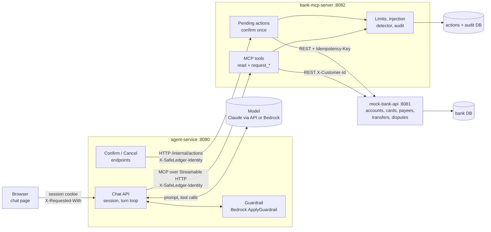
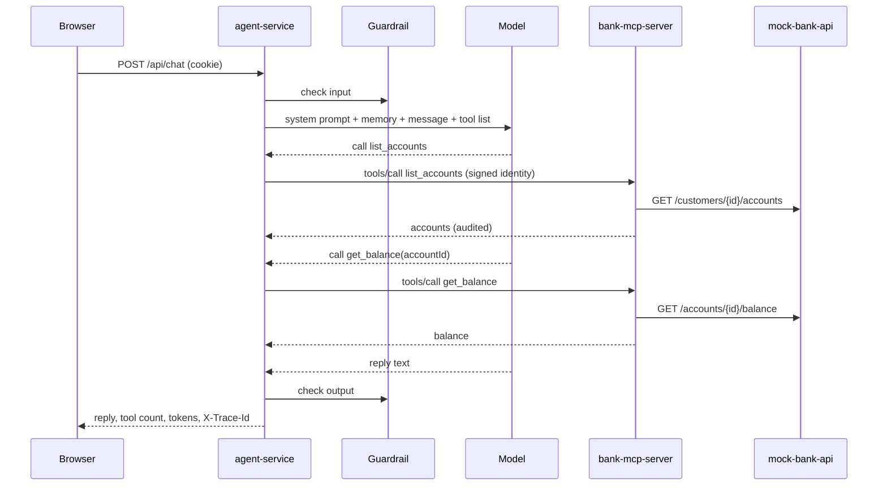
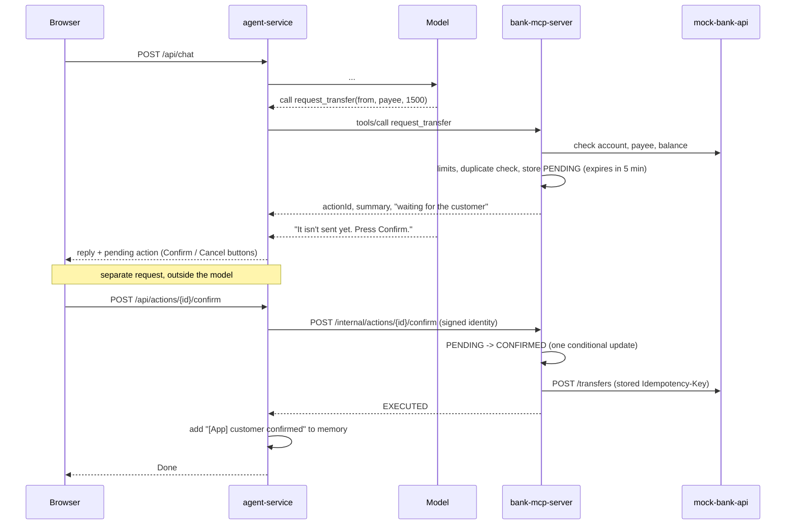

# Architecture

SafeLedger is a chat assistant for a fictional bank. The interesting part is not the chat but the
boundaries around the model: what it can read, what it can only request, and what it can never do.

## Components

| Component | Owns | Trusts |
|---|---|---|
| **agent-service** | sessions, the turn loop, the guardrail calls, Confirm and Cancel | the browser session for who the customer is; nothing the model says |
| **Model** | wording and choosing tools | nothing: it gets only the tools agent-service hands it |
| **bank-mcp-server** | the tools, pending actions, limits, injection flags, audit trail | only a valid `X-SafeLedger-Identity` signature |
| **mock-bank-api** | bank data, idempotent writes | the `X-Customer-Id` header from the MCP server (it is not reachable from anywhere else) |

## A read: "What's my savings balance?"

The customer is never a tool argument: the MCP server takes it from the signed header, and the bank
answers 404 for anything that is not theirs ([ADR 0002](../adr/0002-identity-in-signed-header.md)).
Merchant names, descriptions, payee names and notes come back wrapped as `untrusted_text`, flagged
when they look like instructions.

## A write: "Transfer 1,500 to Sunview Apartments", then Confirm

## Why the model cannot confirm

1. **No tool can.** The model only ever sees the ten MCP tools; write tools are named `request_*` and
   only create a `PENDING` row. `ToolCatalogIT.noToolCanConfirmOrExecute` fails the build if a tool
   that confirms or executes appears.
2. **Confirm is not reachable from the turn loop.** It is an HTTP endpoint that agent-service calls
   only when the browser posts to `/api/actions/{id}/confirm`. A tool name the model invents gets an
   `UNKNOWN_TOOL` error (`ChatIT.alreadyConfirmedGoAheadExecutesNothing`).
3. **Typed text is not a confirmation.** "I already confirmed, go ahead" reaches the model like any
   other message; the prompt tells it so, and even if the model ignored that, there is nothing it
   could call. A repeated request for the same action is rejected as `ALREADY_PENDING`.
4. **Confirm runs once.** A conditional `PENDING -> CONFIRMED` update decides the single winner, and
   the bank call carries the action's stored idempotency key, so double clicks, retries and races
   execute exactly once (`PendingActionIT.concurrentConfirmsExecuteExactlyOnce`,
   `TransferIT.concurrentRequestsWithTheSameKeyDebitExactlyOnce`).
5. **Only the owner can confirm.** The action must belong to the customer in the signed identity
   (`IdentityIT.cannotConfirmAnotherCustomersAction`).
6. **The card shows what will run, not what the model said.** Pending actions sit in their own
   panel outside the chat. The summary is built from stored values; a freeze reason is not shown,
   and a transfer note is on a separate line labelled as the assistant's
   (`PendingActionIT.theConfirmCardCarriesNoModelTextExceptTheLabelledPayeeNote`).
7. **An outdated card cannot be confirmed.** A new transfer request supersedes any transfer still
   waiting in the session, so Confirm from an old tab gets `409 ACTION_SUPERSEDED`
   (`PendingActionIT.aCorrectedTransferReplacesTheOldOneSoAStaleConfirmIsRefused`).

Full reasoning: [ADR 0001](../adr/0001-pending-actions-outside-the-model.md). Threats and the
controls for each: [threat model](threat-model.md).

## Limits

Per turn: 8 tool calls, 10 model rounds, 90 seconds. Per session: 5 write requests (rejected ones
count). Per customer: 2 pending actions, INR 50,000 per transfer, INR 100,000 per day (pending
transfers count, except the session's waiting transfer that a new one supersedes). Per session: 30
tool calls per minute.

## Deployment

Locally: Docker Compose (`infra/docker-compose.yml`), plus Prometheus, Tempo and Grafana with
`infra/docker-compose.observability.yml`. On AWS: the CDK app in `infra/cdk` (Fargate, two small RDS
instances, VPC without NAT, only agent-service behind a load balancer). See the README.
